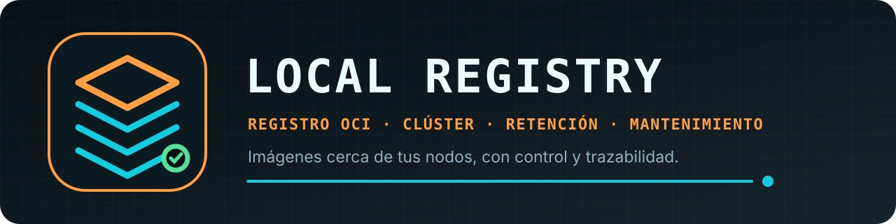

<p align="center">
  
</p>

<p align="center">
  
  
  <a href="LICENSE"></a>
</p>

# Local Registry

Local Registry es un registro privado de imágenes OCI con panel web, mantenimiento y
sincronización entre nodos. Se ejecuta en un único contenedor y guarda tanto las imágenes
como su configuración en un solo volumen persistente.

Funciona con Docker Engine en servidores Linux `amd64` y `arm64`, incluidos equipos
Raspberry Pi con sistema operativo de 64 bits.

## Funciones principales

- Registro HTTPS compatible con las operaciones habituales de Docker y OCI.
- Credenciales por aplicación y permisos separados para descargar, publicar y borrar.
- Panel web con usuarios, sesión y configuración persistente.
- Retención configurable y etiquetas protegidas.
- Limpieza segura de blobs sin uso.
- Comparación y sincronización entre varios registros.
- Coordinación del mantenimiento para no detener todos los nodos a la vez.
- API de estado y administración.

## Instalación con Docker

Crea un directorio persistente y arranca la imagen publicada:

```bash
sudo mkdir -p /srv/local-registry

sudo docker run -d \
  --name local-registry \
  --restart unless-stopped \
  --init \
  --read-only \
  --cap-drop ALL \
  --security-opt no-new-privileges \
  --pids-limit 256 \
  --tmpfs /run:rw,nosuid,noexec,size=16m,mode=0755 \
  --tmpfs /tmp:rw,nosuid,noexec,size=32m,mode=1777 \
  -p 5000:5000 \
  -p 5001:5001 \
  -v /srv/local-registry:/var/lib/registry \
  ghcr.io/ezr43l/local-registry-s:stable
```

Abre `https://SERVIDOR:5001`. La aplicación genera su propia identidad de certificados;
comprueba su huella e instala su certificado público en los clientes de confianza.
Para crear la primera cuenta, obtén el código inicial desde la consola del contenedor:

```bash
sudo docker exec local-registry cat /var/lib/registry/.local-registry/security/bootstrap-code
```

El registro estará disponible en `https://SERVIDOR:5000` y exigirá credenciales propias
de aplicación, creadas desde Configuración. El usuario del panel no autoriza por sí solo
las descargas o publicaciones de imágenes.

También puedes utilizar [Docker Compose](docker-compose.yml) o la
[plantilla para Unraid](unraid/my-Local-Registry.xml). Ajusta las rutas y los puertos al
entorno donde lo instales.

## Primer arranque

El asistente solicita:

- nombre del nodo y zona horaria;
- política de retención y etiquetas protegidas;
- horario de mantenimiento;
- miembros del grupo, si habrá varios registros;
- coordinador y origen de sincronización.

Para una instalación independiente sólo es necesario declarar el nodo local. El primer
nodo de un grupo genera un código de incorporación que permite añadir los demás sin
copiar secretos manualmente.

Toda la configuración puede revisarse después desde el panel.

La sección de seguridad permite definir las direcciones del certificado, las redes
autorizadas y las credenciales de cada cliente. Para una migración desde HTTP,
prepara los certificados y las credenciales de todos los clientes antes del corte:
[guía de acceso seguro](docs/SECURE-REGISTRY.md).

## Datos y copias de seguridad

El volumen `/var/lib/registry` contiene:

- imágenes y blobs OCI;
- configuración del panel;
- cuentas y credenciales generadas;
- historial y estado de mantenimiento.

Una copia coherente de ese volumen permite restaurar la instalación completa.

## Mantenimiento

La retención está desactivada hasta que el administrador configure una política. Las
acciones destructivas requieren una sesión iniciada y confirmación explícita.

En un grupo de nodos, el coordinador reserva primero la operación, aplica la retención,
ejecuta la limpieza de cada registro por turnos y termina comprobando la sincronización.
Si falta un nodo necesario, la operación se detiene sin borrar datos.

## Seguridad

Mantén el registro en una red controlada y limita los puertos a sus clientes y
administradores. HTTPS y la autenticación de imágenes están integrados en el mismo
contenedor. Protege el volumen persistente: contiene imágenes, la identidad de
certificados, configuración y credenciales internas. El código de incorporación del
grupo es secreto y sólo debe compartirse con sus administradores.

La referencia de configuración está en
[docs/CONFIGURATION.md](docs/CONFIGURATION.md).

## Soporte

El soporte se presta en la comunidad de Discord de Unraides:

https://discord.gg/8MAT6ZGJTW

No publiques contraseñas, tokens, códigos de incorporación ni registros con datos
privados al solicitar ayuda.

## Licencia

Código y documentación: [Apache License 2.0](LICENSE).
Las licencias de los componentes incluidos se detallan en
[THIRD_PARTY_NOTICES.md](THIRD_PARTY_NOTICES.md).
